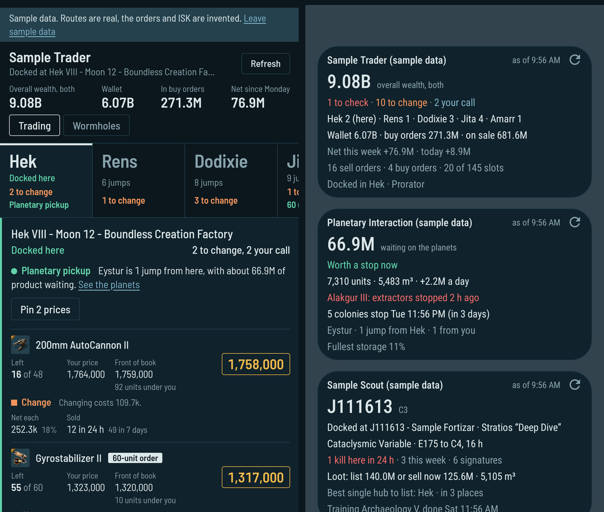

# Eve Ops

A live trading board for one EVE Online character: every open order against the current market book, the exact legal price to type at each hub, the route between hubs with the last hour's losses, and the timers that matter (planets, skill queue, jump clone).

It is a static page. There is no server and no database: your browser talks straight to EVE's API (ESI) and EVE's login.

Live at <https://clockwerks77.github.io/eve-ops/>. Add `#demo` to the address to look around with sample data.

## Signing in

"Log in with EVE" uses EVE's single sign-on with PKCE, the flow meant for apps that cannot keep a secret. The page never sees a password and there is no secret key anywhere in this repository. The Client ID in `js/config.js` is public by design.

After sign-in the browser holds a refresh token in its own storage (`localStorage`). It is sent only to `login.eveonline.com`. Each device signs in separately. "Sign out" removes it from that device; to revoke access everywhere, remove the application under *Third Party Applications* in EVE account management.

All requested scopes are read-only in practice. `esi-planets.manage_planets.v1` is the scope that allows reading extractor timers; ESI offers no way to change a colony.

Note that every site under `clockwerks77.github.io` shares the same browser storage, so only host pages you wrote yourself on this account.

## What the page works out

- **Position** of each sell order among sell orders in the same station, and of each buy order among bids that can be filled at its station (range is checked).
- **Price to type**: one legal step under the front of the book (sells) or over the top bid (buys). EVE prices carry four significant figures, so the step is 1,000 ISK above 1M, 100 ISK above 100k, and so on.
- **Call**: Change (a routine step), Big move (the front is more than 2% away from your price: dump or repricing is your call), Sniper (a few units just under you), Hold (the front is below your cost, or at or below the Jita sell price), Leading. Two orders for the same item in one station are always given the same price, and each is named by its size.
- **Net each**: `price × (1 − broker − sales tax) − cost`. Cost is first-in first-out over the wallet transactions EVE still returns (about six weeks), so it is an estimate. The tracker workbook stays the ledger of record.
- **Hub tabs**: one tab per hub with open orders, nearest first. The tab for the hub you dock in (or fly into) selects itself; picking another tab by hand holds until you move again.
- **Routes**: shortest and secure, one square per system coloured by security status, a red cap where ships or pods were lost in the last hour (`ship/pod` counts listed beside it).
- **Overall wealth**: wallet + ISK held in buy orders + sell orders at your list prices + everything in hangars and ships at EVE's universe-wide average price (blueprint copies left out). One character only, and an estimate.
- **Checks**: an order outside your hubs, listed for fewer than 90 days, priced far from the book (decimal slips), or selling below cost gets a red "Check" with the reason.
- **Big moves** are shown with the hub region's last seven days of history (average price, units a day) and a reading: looks like a dump, the market has moved, or could be either.
- **Planetary Interaction**: each colony's product, the units waiting on the planet now and gained per day, the lowest ask in every hub, and a pickup call. EVE reports a colony only as it was when last opened in game, so the page rolls each one forward itself (extractor decay curve, factory cycles, storage limits); `pi.worth` in the settings is the value at which a pickup becomes "worth a stop". The hub nearest the colonies carries a "Planetary pickup" marker when it is.
- **Since you last looked** (side panel): sales and purchases since you last pressed "Mark as seen", orders that sold out, filled, expired or were cancelled, and lines that were leading and are now undercut. Kept per device.
- **Haul manifest** (Jita tab): what is waiting in the Jita hangar, its volume against the cargo figure you enter, the lowest ask in each hub, and where to take each item (a hub where you sold it this week first, then the highest ask).
- **Restock shortlist** (Jita tab): lines with four days of stock or less, or sold out this week, with units to bid, the bid to type and the net at the hub price.
- **Pins**: "Pin prices" freezes the prices for a stop while you work through it. Each row then waits until the market book shows that exact price.
- **Copied marks**: pressing a price copies it and marks the row without adding a line: the button goes quiet with a tick, the time sits on its top border (press the time to remove the mark), and the newest reads "Last" with a bar at the row's left edge. The stop shows "3 of 7 copied", so the amber prices left are the ones still to do. The mark becomes "Changed" when the market book shows the order at that price; the Call column says so if newer data still shows the old price ("not in the book") or if the price to type has changed since. "Clear copied marks" clears a stop. Bids on the restock shortlist are marked the same way. Kept on each device for 6 hours (`copied` in `js/config.js`).
- **Slow line**: a routine undercut on a sell line with no sale at that hub in 7 days, on stock bought more than 7 days ago, is offered as your call instead of "Change", with the fee it would cost (`slowFee` in `js/config.js`).
- **Trip plan** (above the hub tabs): the hubs with something to do, in the order that takes the fewest jumps from where you are, drawn as a route line. Each stop is a dot with its name and what there is to do under it; the leg that gets you there is a run of squares, one per system, coloured by security, with a red cap where ships or pods were lost in the last hour ("hot"). Stock waiting in the Jita hangar is picked up before the hubs it is going to; if one of those is the hub you are docked in, it appears twice (its orders now, the drop on the way back). Cargo already in the hold adds "list N from cargo" at the hub where it sells best. Shortest or secure routes, leave a hub out with its ×, hide the plan to one line.
- **In your cargo hold** (on every hub's panel, under the haul manifest in Jita): items you trade that are in the ship you are flying, the lowest ask at each hub, where to take each, and the price to list it at in the hub the panel is for. That price follows the Call column's rules: your order for the item there if you have one, else one legal step under the front, and none where that would sell under cost or under Jita. EVE reports cargo once an hour.
- **Row height**: where the rows are a table, the Call column keeps to two lines so a row with a Check or a long reason is no taller than the others. Hover shows all of it; a press keeps that row open.
- **Weekly close** (under Planetary Interaction): one row per Monday-to-Sunday week. Sold and net after fees come from your sales; cost is what the wallet shows you paid, first in, first out. Broker fees and tax, wallet change and wallet at close are exact, from the wallet journal (EVE keeps 30 days). Type the tracker's net beside a finished week and the row says Tied or Off with the gap; after two tied weeks in a row (`tieOut` in `js/config.js`) the page says it can take over as the ledger. "Realized net to date" adds the weeks on the page to the figure you carry in from the tracker.
- **The tracker's cost basis**: units sold with no purchase in EVE's history (bought before it starts, or never bought) have no cost of their own. "Paste rows from the tracker" takes rows copied from the workbook's Order Tracking sheet (header row included; columns are found by their headers) and uses each item's Unit Cost for those units: the row at the same hub listed most recently before the sale. Each week says how many units used it. Closed weeks are worked out again when newer rows are pasted, as long as EVE still has that week's sales. The rows travel with sync. `costs.prefer` in `js/config.js` can make the tracker's cost win for every item it lists.
- **Sync between devices** (side panel, off until you turn it on): pins, copied marks, "Mark as seen" and the weekly closes are kept the same on every device through one small file in a secret gist on your GitHub account. Make a fine-grained token with no repository access and the account permission Gists set to read and write, and paste it on each device; it is kept in that device's storage and sent only to `api.github.com`. A secret gist is unlisted, not private: anyone with its address can read it, so nothing but that game state goes in it.

## Wormholes tab

A second view for a second character (signed in separately as the "wormhole pilot"):

- **Tracking**: the pilot's system is read every 15 seconds. A change of system made while the page is open becomes a link in the chain; stargate jumps are not drawn. The chain is kept in this browser.
- **Per system**: class (from the region), effect and statics (bundled table), kills over the last 7 days from zKillboard (EVE publishes none for wormhole space), and the signatures you paste from the probe scanner (Ctrl+A, Ctrl+C), grouped by type with new ones marked.
- **System map**: sun, planets and any structure the pilot has docked in at their true bearing, distances compressed. Signatures sit on an outer ring because EVE gives no position for them. Hover or tab to anything for details. Beside the map: what the system's effect does at that class, each static's lifetime, mass and the ship sizes that fit.
- **Connections**: for each link in the chain, the wormhole type, whether it is fresh, end of life or mass-critical (set by hand), and a way to remove it.
- **Kills by hour**: the newest player kills in the system by hour of day (EVE time), to show when the locals are active.
- **Loot and gas to hand over**: the pilot's exploration loot and gas, wherever it sits (station hangars, a structure, a ship's cargo or gas hold), with volume. For each item: the lowest ask and top bid in every hub, the jumps from where the loot sits to each hub, the hub to **list in** and the hub to **sell now in**, and totals after fees. A table above compares taking the whole pile to one hub.
  - *List in* is the highest ask among hubs where the pile would sell within `loot.days` at `loot.share` of that region's daily trade (14 days at 15% unless changed in the settings). A lone listing more than 1.5 times the Jita ask is passed over and counted at the Jita ask. If every hub is slower than that, the quickest one is named.
  - *Sell now in* fills the bids standing at the hub station, in its system or region-wide, best price first, with every unit held, so a thin bid book shows as "bids take N of M".
  - What counts: salvaged materials, ancient salvage, sleeper components, datacores, decryptors, relics and similar loot groups; harvested gas, raw or compressed. Blueprint copies are listed but cannot be sold on the market.

Wormhole statics, effects and wormhole types in `js/whdata.js` are derived from data files in [Wanderer](https://github.com/wanderer-industries/wanderer) (MIT License, Copyright (c) 2024 Wanderer Industries).

## Expedition tab

Planning and running the four-pilot wormhole camp. Built so far: Muster, Kit & Shopping (Phase A) and the Camp board with its timers and session log (Phase B). The bank manifest and the strike checklist are the next phase.

- **No sign-in and no network needed.** Open `#expedition` (or the link on the sign-in screen) and it works. Everything typed here is kept on this device only, under the storage key `eveops.expedition`. It is deliberately left out of the optional GitHub sync, because it holds other people's names.
- **Adam is one seat.** Khiana Kyn and Todashi Kitsune are on one account, so they are one pilot with a mode switch (Khiana-mode: scout and combat lead in the Odysseus; Todashi-mode: boosts and compression in the Porpoise). The other character always reads as logged off, and Adam cannot be put in a second seat.
- **Muster.** A card per pilot with the six muster questions (who they are, what they can fly, whether they will train an assigned seat, corp home or nomad, which nights, loss tolerance), kit readiness, and the gaps in plain words with a training estimate from nothing (1,800 skill points an hour as an Omega, 900 as an Alpha). The Can fly table can be ticked directly.
- **Kit & Shopping.** Every pilot is tracked against the standard four hulls: Prospect, Procurer, Praxis and the PvP reship (Missing, Owned, At camp; the last two count as ready). Each hull takes one fit pasted in EFT format, bought in Jita or Rens. Camp stock lines are Each, for each pilot or for the camp, doubled for spares, less what is already held. The shopping list is every missing hull with its fit plus the stock still short, as text for the game's Multibuy window (Market, Multibuy, Import from clipboard). It carries no prices. A line with no item name, such as the PvP hull before a doctrine is agreed, is listed underneath as not yet on the list.
- **Night 0 checklist**, with the time each box was ticked.
- **Export and Import.** Export copies the whole module as JSON (or saves a file in a browser) and the muster as Markdown; Import replaces what is on the device with a pasted export. Do this before changing phones.
- The starting stock figures, the training estimates and the standard kit are in `js/config.js` under `expedition`.

**Camp board.** The first section of the tab, and where the tab opens while a camp exists. Once a camp's first night has started, opening the page with no address (the app's icon) lands here instead of on Trading, until the camp is ended; links and widgets that name a view still go to that view.

- **Setting up:** system, class, statics and stage are typed in. A hole is put on the board for each static. Night 1 cannot start until every Night 0 box is ticked.
- **Status line:** the camp, the night, the window that is running, and which of Adam's two characters is logged in (the other reads as logged off). Switching mode during a window changes that window's record.
- **Where we left off:** shown whenever no window is running: when the night started or ended, the last window (type, times, who flew, who picketed, its note) and the holes as last recorded.
- **Windows:** Mining, Gas, Ratting, Defence or Exploration. Starting one takes who is present and the picket order (the seats' order unless changed) and how often the picket changes (45 minutes unless changed). Ending one writes a `WindowRecord` (`window_id`, `camp_id`, `type`, `start`, `end`, `pilot_ids_present`, `adam_mode`) into the store for the later ISK-per-hour module.
- **Picket rotation:** changes are taken as made when their time comes, whether or not anyone touches the phone, so the rings keep coming in order and the log records who picketed when. A change can be confirmed (which stops the second ring), put off ten minutes (the earlier pilot stays on and the whole rotation moves), or made early.
- **Hole board:** where each hole leads, its mass state, end of life with the time it was first seen, picketed, bookmarked both sides. Kept by hand; the Wormholes tab has the live chain.
- **Timers:** a picket change rings with the next pilot's name and rings once more five minutes later if nobody confirms it; a gas site rings 15 minutes after entry; a hole at end of life rings at 60 and at 15 minutes left of its four hours. Times are stored, so they survive closing the page.
- **Session log:** every window by night, with its note, and one Markdown summary per night to copy into a notes vault.
- **Ending a camp** is by hand until the strike checklist exists. Its log stays under Earlier camps.

The timers ring only from the Android app (build 1.0.12 or newer): the page hands the app the list of what to ring for, and the app sets one Android alarm per ring, so they sound with the app shut or the phone folded, and are set again after the phone restarts. They play on the alarm volume, so they are heard with the phone on silent; Android's notification settings for the app list them as "Camp timers". Confirm and Snooze on a notification work without opening the app. In an ordinary browser the board only counts down while it is open, and says so.

The page also keeps a copy of itself on the device (`sw.js`), so it opens with no network. Trading and Wormholes still need EVE's servers for their numbers; the Expedition tab does not.

## Android app and widgets

`android/` holds a small Android app (Android 12 or newer). It shows this same page full screen and adds three home-screen widgets:

- **Trading**: overall wealth, how many orders to change, check or judge, which hubs they are at, wallet, ISK in buy orders and on sale, the week's net.
- **Planetary Interaction**: what is waiting on the planets, whether a pickup is worth it, when extractors stop or have stopped.
- **Wormholes**: where the wormhole pilot is, the system's class, effect and statics, kills there, and the loot to hand over.

How it fits together:

- The app loads the live page, so a change to the page reaches the app without a new APK. Only changes under `android/` need one.
- **Sign-in** opens EVE's login in the phone's own browser. EVE sends the browser back to this page, which hands the one-time code to the app (`eveops://auth`). The app keeps the sign-in in its private storage, excluded from backups, and gives the page short-lived access tokens when it asks. The page inside the app never holds the refresh token.
- **Widgets** show a summary that the page itself works out and hands to the app, so a widget can never disagree with the board. While the app is closed, the app loads the page off screen about every half hour (as often as Android allows a background app) and on a tap of a widget's refresh arrow. Each widget says when its figures are from.
- **Text follows the widget's size.** For each size a widget is shown at, the app shows as many whole lines as fit and draws them as large as that size allows (`Fit` in `Faces.kt`). Resizing a widget redraws it. Lower lines drop first on a small widget.
- A tap on a widget opens the matching view.
- **Notifications** (off until you turn one on in the dashboard's Phone notifications panel, shown in the app): an order loses the lead, extractors stop, a launchpad is nearly full. The page lists what there is to say in the summary it hands the app; the app (`Alerts.kt`) tells you once about each new thing after a background refresh, and stays quiet while the dashboard is on screen. Android asks once whether Eve Ops may notify; the panel can ask again, and from build 1.0.10 it can open Android's notification settings for the app.
- **Camp timers** (`Timers.kt`): the Expedition tab hands over the list of what to ring for; the app keeps it, sets one alarm-clock alarm per ring, posts them on the "Camp timers" channel, and keeps what was pressed on a notification until the page next asks. Because they are alarm-clock alarms, the phone's own "next alarm" indicator shows the next camp ring.

Getting the APK: GitHub builds it (`.github/workflows/android.yml`). Every push under `android/` is compiled, unit-tested and run on an emulator against the sample data. A release with the APK attached is published when a commit changes `android/RELEASE` (put the next number in it), or from the Actions tab: *Android app* → *Run workflow*.

Signing: the workflow signs with the keystore in the repository secret `SIGNING_KEY` (a PKCS12 keystore, base64, alias and password `eveops`; the secret itself is what keeps it private). Without that secret it signs with a throwaway key: the APK installs, but Android will not install a later build over it.

## How fresh the numbers are

EVE republishes on its own timers and the page refetches as each one lapses:

| Data | Updates every |
|---|---|
| Market books | 5 minutes |
| Your order list | 20 minutes |
| Wallet balance | 2 minutes |
| Sales and purchases | 60 minutes |
| Hangars | 60 minutes |
| Planets | 10 minutes |
| Location | 5 seconds |

Your own orders are matched by ID inside the market book, so a price change shows within 5 minutes without waiting for the 20-minute list. A brand-new order appears once the list refreshes.

## Settings

`js/config.js` holds the fees (broker 1.5%, sales tax 3.375%, 0.39% per price change), the sniper and big-move thresholds, the slow-line threshold, the loot hand-over pace (`loot.share`, `loot.days`), and the item types left out of trading math. The Android app repeats the Client ID and scopes in `android/.../Config.kt`: change both together.

## Deploying

Push to `main`. Bump the version number in `index.html` (the `eveops-version` meta tag and every `?v=`) in the same commit: browsers cache the files for ten minutes otherwise, and an open board checks that number every five minutes and offers a reload when it changes.

## Files

- `index.html`, `css/app.css` — the page and its three layouts (monitor, tablet, phone)
- `js/logic.js` — price steps, book position, calls, FIFO ledger (no network; unit-tested)
- `js/esi.js` — sign-in and requests
- `js/sync.js` — the optional sync file on GitHub
- `js/app.js` — loading, model, drawing
- `js/demo.js` — sample data behind `#demo`
- `js/wh.js`, `js/whdata.js` — the Wormholes tab and its table of statics, effects and wormhole types
- `js/expedition.js` — the Expedition tab (its rules are in `js/logic.js`, its starting figures in `js/config.js`)
- `sw.js` — keeps a copy of the page's own files on the device so it opens with no network
- `tests/logic.test.js` — run with `node --test tests/logic.test.js`
- `android/` — the Android app: `Auth.kt` (sign-in), `Bridge.kt` (link to the page), `Refresh.kt` (background refresh), `Faces.kt` (what each widget says and how its text fits; unit-tested), `Widgets.kt`
- `tools/` — checks to run before a push:
  - `node tools/render.js <folder>` draws the sample data at monitor, tablet and phone size and reports page errors or sideways overflow
  - `node tools/copy-test.js` presses price buttons on the sample data and checks the copied marks (clipboard, progress, Undo, clear)
  - `node tools/board-test.js` works the trip plan and the weekly close on the sample data
  - `node tools/sync-test.js` runs two stand-in devices against a stand-in for GitHub's gist API and checks that marks, pins and tracker figures travel
  - `node tools/camp-test.js` runs a camp night on the Camp board with the clock moved by hand and a stand-in for the app: the Night 0 gate, a picket rotation across three pilots, what the app is told to ring for, a snooze from the phone, gas and hole timers, the log, the Markdown, reopening on the re-entry card
  - `node tools/expedition-test.js` works the Expedition view with nobody signed in: Adam's one seat, a pilot's muster questions, kit readiness, the shopping list, export and import, and a reload with the network off
  - `node tools/app-link-test.js` checks the page's side of the Android app link with a stand-in for the app (give it a file name to rewrite the Android test fixture `android/app/src/test/resources/snapshot-demo.json`)
  - `tools/ci.sh [commit]` waits for GitHub's Android build and emulator run and prints what they reported
  - `tools/screens.sh <folder>` fetches the emulator screenshots
  - `tools/whdata.py` rebuilds `js/whdata.js` from Wanderer's data files

The page sets a content security policy that allows requests only to `esi.evetech.net`, `login.eveonline.com`, `zkillboard.com`, `api.github.com` (the optional sync file) and the page's own address, and scripts only from this repository.

The typeface is Barlow Semi Condensed (SIL Open Font License, see `fonts/LICENSE-Barlow.txt`). EVE Online and its data belong to CCP hf.
